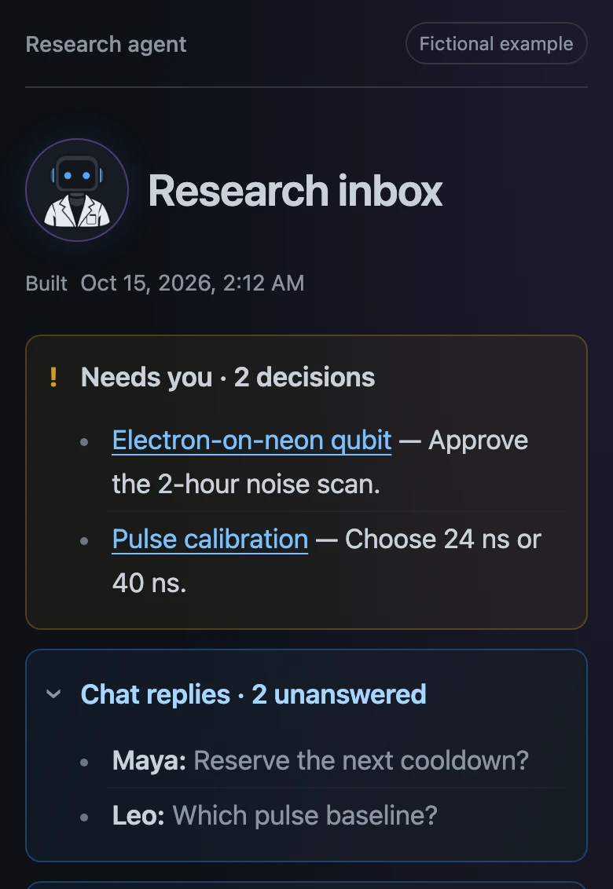
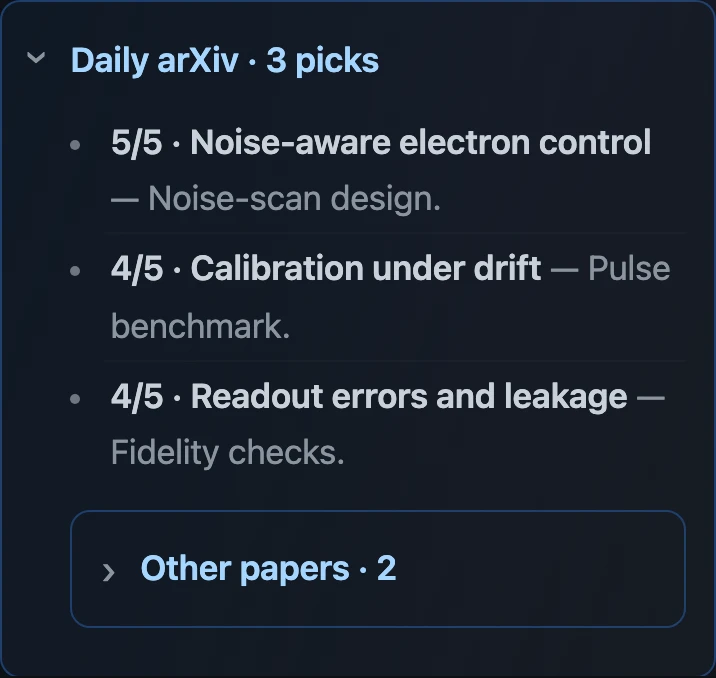
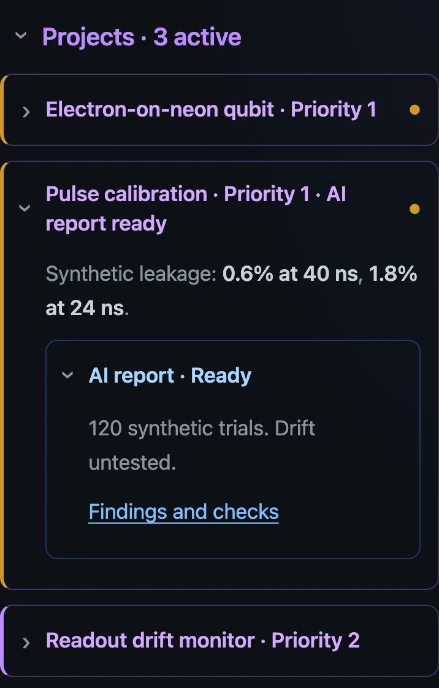

# Research agent

A small, local research notebook for a person working with an AI agent through a coding harness.
The researcher sets direction; the agent runs bounded work, records evidence, and brings decisions back to an inbox.

<p align="center">
  
</p>

## The notes

| Note | Purpose |
|---|---|
| Project | Research question, human-owned status, and tasks. |
| Project index | Decisions, unanswered messages, three relevant papers, and collapsed projects. |
| Daily note | Main, secondary, and personal outcomes; scheduled and unfinished tasks. |
| Dated AI log | Work performed, evidence, session, and proposed project updates. |
| Literature brief | Full review retained behind the compact inbox selection. |
| People and groups | Explicit relationships with evidence; names alone do not establish membership. |

The [fictional experimental-qubit vault](examples/neon-qubit) is the complete minimal example.
It uses a fictional electron-on-neon qubit experiment with synthetic data, contains no real researcher data, and claims no completed experiments.
The dashboard demonstrates an invented working day; its people, paper titles, progress, and numerical results are synthetic.
Copy it outside this repository before using it. Obsidian is optional; task query blocks require its Tasks plugin.

## Run the literature review

```sh
uv sync --locked
cp config.example.json config.local.json
# Set your private vault, profile, timezone, and author-name variants.
uv run python daily_brief.py --date 2026-01-15
```

A signed-in Codex CLI is required. This command fetches the selected arXiv release and makes model calls.
The example uses quantum physics and condensed matter. The notes illustrate analysis and human review; hardware control is outside this kit.

The workflow screens titles, abstracts, and full papers, then publishes a brief and a dated AI-log link.
The inbox shows the three highest relevance scores; other papers are collapsed. Scores indicate reading usefulness, not scientific quality.
Your own papers remain eligible and are labelled from private `reader_names` configuration.
Models receive evidence and return structured data without tools. Hypotheses remain proposals until you authorize a test.
Completed releases are immutable; model state and backups stay outside the notes.

## View the project index anywhere

Phone views with fictional example data.

### Decisions and replies

Unblock work: approvals and unanswered questions.



### Daily arXiv

Three reading picks; the rest stay collapsed.



### Projects and AI reports

Scan priorities, open a result, follow its report.



Compile just the index into a small responsive HTML page:

```sh
uv run python -m research_agent.site \
  'examples/neon-qubit/Research/Projects/Project index.md' \
  --output dist --label 'Fictional example'
```

Open `dist/index.html` locally. It preserves Obsidian callouts, collapsed project cards, priority accents, and links to cards on the same page.
It exports only the selected index, a stylesheet, and the bundled AI-scientist image; linked notes are not copied. Other note references stay plain text.
Obsidian task queries are not executed. Use explicit task summaries in the index for the web snapshot.

GitLab CI tests every branch and builds the fictional dashboard. The default branch also publishes it with GitLab Pages. Find the deployed URL under **Deploy → Pages**.

Only the fictional example is published. Real notes, private configuration, and credentials do not belong in this demo repository.

## Keep it private

Only generic code, templates, fictional examples, and this documentation belong in the public repository.
Keep real notes, author mappings, chat exports, credentials, publication snapshots, and backups in private storage.
Local configuration and `.local/` are ignored by Git. An ignore rule does not remove data from existing Git history.

Chat is an optional input: connect Slack, a forum, or another service through your own adapter.
The core does not post messages or operate laboratory equipment.

## Check

```sh
uv run python -m pytest
```

Tests use temporary notes and mocked services. The example is a layout demonstration, not a scientific benchmark.
